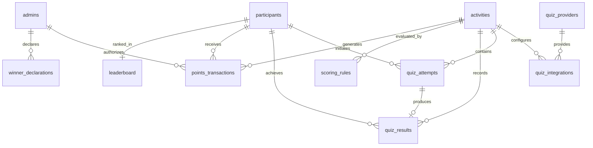

# Database Schema Specification

This document defines the 11 normalized tables that form the central backbone of the **Event Points Management System**. All developers must build against these exact column definitions, foreign keys, and constraints.

---

## 🗄️ Entity-Relationship Diagram

---

## 📋 Table Definitions

### 1. `participants` (Owner: Person 1)
| Column | Type | Constraints | Description |
|---|---|---|---|
| `id` | UUID | PRIMARY KEY, DEFAULT gen_random_uuid() | Internal database identity |
| `participant_code` | VARCHAR(32) | UNIQUE, NOT NULL | Human-readable ID (e.g., `EVT26-P0102`) |
| `full_name` | VARCHAR(128) | NOT NULL | Participant's registered full name |
| `email` | VARCHAR(255) | UNIQUE, NOT NULL | Contact email address |
| `phone` | VARCHAR(32) | NULLABLE | Optional mobile contact |
| `organization` | VARCHAR(128) | NULLABLE | School / Company / Team |
| `avatar_url` | TEXT | NULLABLE | Profile avatar image link |
| `status` | VARCHAR(32) | DEFAULT 'active' | `active`, `disqualified`, `withdrawn` |
| `created_at` | TIMESTAMPTZ | DEFAULT NOW() | Registration timestamp |

---

### 2. `admins` (Owner: Person 2)
| Column | Type | Constraints | Description |
|---|---|---|---|
| `id` | UUID | PRIMARY KEY, REFERENCES auth.users(id) | Supabase auth user reference |
| `full_name` | VARCHAR(128) | NOT NULL | Admin user name |
| `email` | VARCHAR(255) | UNIQUE, NOT NULL | Admin email address |
| `role` | VARCHAR(32) | DEFAULT 'event_admin' | `super_admin`, `event_admin`, `referee` |
| `is_active` | BOOLEAN | DEFAULT TRUE | Account state |
| `created_at` | TIMESTAMPTZ | DEFAULT NOW() | Record creation timestamp |

---

### 3. `activities` (Owner: Person 2)
| Column | Type | Constraints | Description |
|---|---|---|---|
| `id` | UUID | PRIMARY KEY, DEFAULT gen_random_uuid() | Activity unique identifier |
| `title` | VARCHAR(128) | NOT NULL | Activity display title |
| `description` | TEXT | NULLABLE | Detailed instructions |
| `activity_type` | VARCHAR(32) | NOT NULL | `online_quiz`, `offline_game`, `bonus` |
| `max_points` | INTEGER | NOT NULL, DEFAULT 1000 | Maximum event points earnable |
| `is_active` | BOOLEAN | DEFAULT TRUE | Whether participants can enter |
| `starts_at` | TIMESTAMPTZ | NULLABLE | Scheduled opening time |
| `ends_at` | TIMESTAMPTZ | NULLABLE | Scheduled closing time |
| `created_at` | TIMESTAMPTZ | DEFAULT NOW() | Record creation timestamp |

---

### 4. `quiz_providers` (Owner: Person 3)
| Column | Type | Constraints | Description |
|---|---|---|---|
| `id` | VARCHAR(32) | PRIMARY KEY | Provider identifier (e.g., `mock`, `kahoot`, `wayground`) |
| `name` | VARCHAR(64) | NOT NULL | Display name |
| `adapter_class` | VARCHAR(64) | NOT NULL | Code adapter registry key |
| `config_schema` | JSONB | DEFAULT '{}' | Provider configuration parameters |
| `is_enabled` | BOOLEAN | DEFAULT TRUE | Activation toggle |

---

### 5. `quiz_integrations` (Owner: Person 3)
| Column | Type | Constraints | Description |
|---|---|---|---|
| `id` | UUID | PRIMARY KEY, DEFAULT gen_random_uuid() | Integration record ID |
| `activity_id` | UUID | UNIQUE, REFERENCES activities(id) | Bound activity |
| `provider_id` | VARCHAR(32) | REFERENCES quiz_providers(id) | Associated provider |
| `external_quiz_url` | TEXT | NOT NULL | Launch or webhook endpoint |
| `webhook_secret` | VARCHAR(128) | NULLABLE | Signature verification secret |
| `settings` | JSONB | DEFAULT '{}' | Provider specific parameters |
| `created_at` | TIMESTAMPTZ | DEFAULT NOW() | Creation timestamp |

---

### 6. `quiz_attempts` (Owner: Person 3)
| Column | Type | Constraints | Description |
|---|---|---|---|
| `id` | UUID | PRIMARY KEY, DEFAULT gen_random_uuid() | Unique attempt tracking ID |
| `participant_id` | UUID | REFERENCES participants(id) | Participating user |
| `activity_id` | UUID | REFERENCES activities(id) | Associated quiz activity |
| `status` | VARCHAR(32) | DEFAULT 'in_progress' | `in_progress`, `completed`, `abandoned` |
| `started_at` | TIMESTAMPTZ | DEFAULT NOW() | Initiation timestamp |
| `completed_at` | TIMESTAMPTZ | NULLABLE | Completion timestamp |

---

### 7. `quiz_results` (Owner: Person 3)
| Column | Type | Constraints | Description |
|---|---|---|---|
| `id` | UUID | PRIMARY KEY, DEFAULT gen_random_uuid() | Internal result ID |
| `attempt_id` | UUID | REFERENCES quiz_attempts(id) | Linked attempt |
| `participant_id` | UUID | REFERENCES participants(id) | Participant reference |
| `activity_id` | UUID | REFERENCES activities(id) | Activity reference |
| `provider` | VARCHAR(32) | NOT NULL | Provider key (`mock`, `kahoot`, etc.) |
| `external_result_id`| VARCHAR(128) | NOT NULL | Platform unique result ID |
| `raw_score` | NUMERIC | NOT NULL | Unconverted raw score from external source |
| `max_score` | NUMERIC | NOT NULL | Maximum possible raw score |
| `completion_status`| VARCHAR(32) | NOT NULL | `completed`, `partial`, `disqualified` |
| `metadata` | JSONB | DEFAULT '{}' | Answers, time elapsed, response breakdown |
| `created_at` | TIMESTAMPTZ | DEFAULT NOW() | Ingestion timestamp |
| **CONSTRAINT** | UNIQUE(activity_id, external_result_id) | Deduplication guard |

---

### 8. `scoring_rules` (Owner: Person 4)
| Column | Type | Constraints | Description |
|---|---|---|---|
| `id` | UUID | PRIMARY KEY, DEFAULT gen_random_uuid() | Rule unique ID |
| `activity_id` | UUID | REFERENCES activities(id) | Associated activity |
| `calculation_method`| VARCHAR(32)| NOT NULL | `linear_scale`, `percentile`, `fixed_brackets`, `threshold` |
| `parameters` | JSONB | NOT NULL | Rule weights, minimum thresholds, multipliers |
| `created_at` | TIMESTAMPTZ | DEFAULT NOW() | Creation timestamp |

---

### 9. `points_transactions` (Owner: Person 4)
| Column | Type | Constraints | Description |
|---|---|---|---|
| `id` | UUID | PRIMARY KEY, DEFAULT gen_random_uuid() | Transaction ID |
| `participant_id` | UUID | REFERENCES participants(id) | Recipient participant |
| `activity_id` | UUID | NULLABLE, REFERENCES activities(id)| Source activity (null if manual award) |
| `quiz_result_id` | UUID | NULLABLE, REFERENCES quiz_results(id)| Source quiz result |
| `points` | INTEGER | NOT NULL | Positive (award) or negative (deduction) points |
| `transaction_type` | VARCHAR(32) | NOT NULL | `quiz_award`, `offline_award`, `bonus`, `deduction`, `manual_correction` |
| `reason` | TEXT | NOT NULL | Audit trail explanation |
| `created_by_admin_id`| UUID | NULLABLE, REFERENCES admins(id) | Admin who authorized manual point changes |
| `created_at` | TIMESTAMPTZ | DEFAULT NOW() | Ledger timestamp |

---

### 10. `leaderboard` (Owner: Person 5)
| Column | Type | Constraints | Description |
|---|---|---|---|
| `participant_id` | UUID | PRIMARY KEY, REFERENCES participants(id) | Participant reference |
| `total_points` | INTEGER | NOT NULL, DEFAULT 0 | Cumulative confirmed points |
| `online_points` | INTEGER | NOT NULL, DEFAULT 0 | Sum of online quiz points |
| `offline_points`| INTEGER | NOT NULL, DEFAULT 0 | Sum of offline game/bonus points |
| `rank` | INTEGER | NOT NULL, DEFAULT 0 | Current overall ranking position |
| `last_updated_at`| TIMESTAMPTZ | DEFAULT NOW() | Timestamp of last recalculation |

---

### 11. `winner_declarations` (Owner: Person 5)
| Column | Type | Constraints | Description |
|---|---|---|---|
| `id` | UUID | PRIMARY KEY, DEFAULT gen_random_uuid() | Declaration identifier |
| `title` | VARCHAR(128) | NOT NULL | Announcement title (e.g. `Grand Finale Winners`) |
| `winners_snapshot` | JSONB | NOT NULL | Frozen top ranking participants & scores |
| `is_locked` | BOOLEAN | DEFAULT FALSE | When TRUE, locks the leaderboard |
| `declared_by_admin_id`| UUID | REFERENCES admins(id) | Authorizing admin |
| `declared_at` | TIMESTAMPTZ | DEFAULT NOW() | Announcement timestamp |
