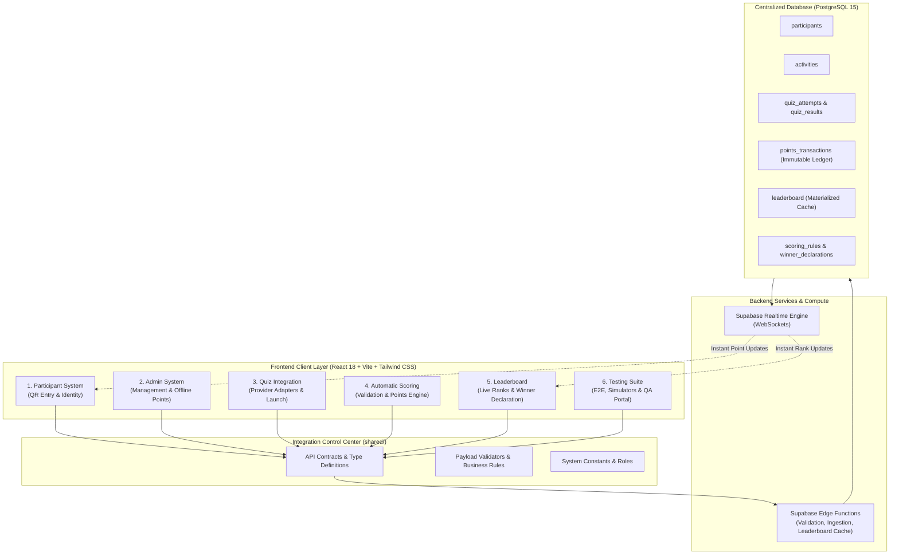

# System Architecture Specification

---

## 1. High-Level Architectural Model

The **Event Points Management System** utilizes a modern, resilient architecture decoupled across 6 independent feature modules, coordinated via standardized API contracts and a centralized Supabase PostgreSQL database.

---

## 2. End-to-End Data Pipeline

### Flow A: Online Quiz Activity
1. **Participant Intake:** Participant scans event QR code; Person 1's module registers identity and stores `participant_id` (UUID) in local state / cookies.
2. **Quiz Launch:** Participant clicks an online activity. Person 3's module creates a record in `quiz_attempts` and opens the provider link with URL query parameters (`?participant_id=UUID&attempt_id=UUID`).
3. **Result Ingestion:** Upon quiz completion, the external platform (or mock adapter) sends the raw score to Person 3's ingestion endpoint.
4. **Scoring & Verification:** Person 4's scoring engine receives the normalized result, checks for duplicate submissions (`external_result_id` uniqueness), evaluates against `scoring_rules`, and writes an immutable record to `points_transactions`.
5. **Leaderboard Refresh:** Leaderboard triggers an update, re-aggregating valid point transactions. Realtime notifications broadcast updated ranks to all screens.

### Flow B: Offline Game & Staff Award
1. **Admin Action:** Staff/Admin logs in via Person 2's portal and selects a participant and offline activity (e.g., Booth Game, Hackathon Bonus).
2. **Transaction Emission:** Admin specifies point value and rationale. Request is routed through Person 4's points engine.
3. **Audit Ledger:** Point change is logged in `points_transactions` with `created_by_admin_id`.
4. **Leaderboard Refresh:** Realtime broadcast reflects the updated score immediately.

---

## 3. Core Architectural Guarantees

1. **Transaction-Only Points (No Direct Mutation):**
   Participant total points are **never stored as a directly mutable number**. Total score is always derived via `SUM(points)` from `points_transactions` where `status = 'confirmed'`.
2. **Idempotency & Duplicate Prevention:**
   Every external score submission must include an `external_result_id`. The database enforces `UNIQUE(activity_id, external_result_id)`. Duplicate webhook hits or page refreshes are discarded safely.
3. **Provider Agnostic Design:**
   Person 3's Quiz Integration module isolates third-party platforms behind a unified `BaseQuizProvider` interface. Supporting Kahoot, Wayground, Quizizz, or custom web forms requires zero modifications to the scoring or participant modules.
