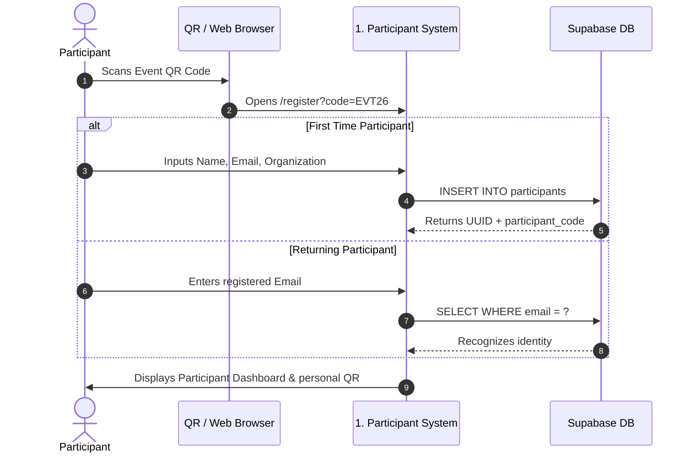
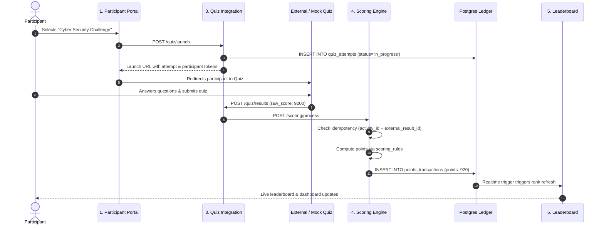
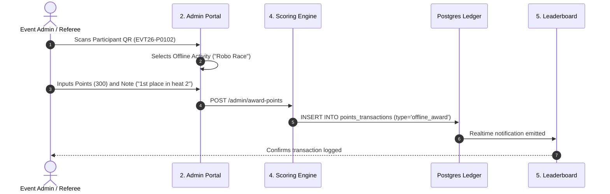

# User Flows Specification

This document maps the primary user and system journeys across all 6 phases.

---

## 1. Participant Journey (Phase 1)

---

## 2. Quiz Attempt & Automated Scoring Flow (Phases 3 & 4)

---

## 3. Offline Points Award Flow (Phase 2 & Phase 4)

